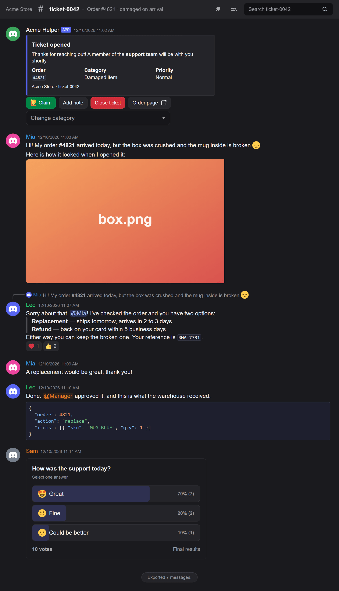
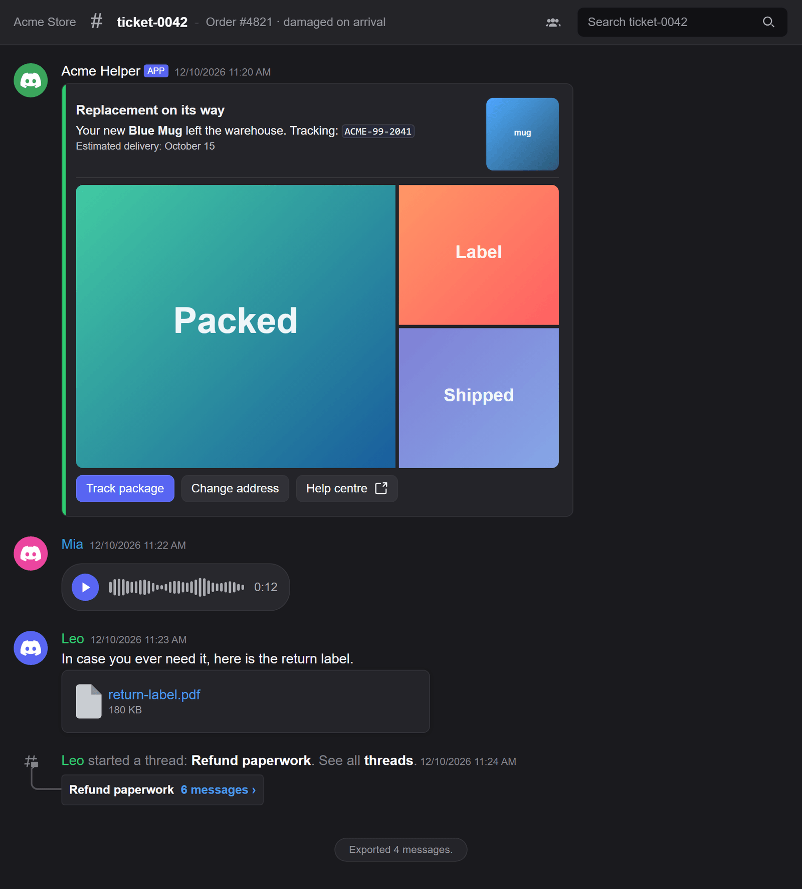

# discord-transcriptify

[](https://www.npmjs.com/package/discord-transcriptify)
[](https://www.npmjs.com/package/discord-transcriptify)
[](./LICENSE)

Turn a Discord channel into a single HTML file that looks like Discord: same colours, same message
grouping, same components. Built for [discord.js](https://discord.js.org) v14 and v15.

```shell
npm install discord-transcriptify
```

```js
const { createTranscript } = require('discord-transcriptify');

const attachment = await createTranscript(channel);
await channel.send({ files: [attachment] });
```



## What it renders

- **Messages** — Discord markdown (bold, quotes, code blocks, spoilers, timestamps), mentions in their
  role colour, replies, edits, reactions, slash command headers, and consecutive messages from the
  same author grouped under one header.
- **Embeds** — every field, including author, footer, thumbnail and image.
- **Components V2** — container (accent colour, spoiler), text display, section with a thumbnail or
  button accessory, media gallery, file, separator, checkbox and radio group.
- **Buttons and select menus** — all styles, link buttons, emoji and the disabled state. A select
  menu opens on a click and lists its options, with their emoji and descriptions.
- **Attachments** — images, videos and audio inline; several images as one grid; any other file as a
  card with its name, size and a download link.
- **Voice messages** — waveform, duration and a play button.
- **Polls** — answers, vote bars and the poll result message. The closing time is shown as a date,
  never as time left.
- **Forwarded messages** — content, attachments, embeds and components of the forwarded snapshot.
- **Threads** — the "started a thread" message with its preview, and optionally every message inside
  the thread.
- **Stickers** — PNG, APNG and GIF as images. Lottie stickers show a placeholder with the sticker
  name, since they need a player script.
- **System messages** — joins, pins, boosts and thread creation.
- **Server tags** next to author names.



The file also carries a small interface for whoever reads it: message search, a member list with
message counts, a list of pinned messages, a list of the saved threads, a full-screen image preview
and a side panel that opens a thread next to the channel. All of it can be [switched off](#interactive-ui).

## Requirements

- Node.js 18.17 or newer
- discord.js v14 or v15
- [`sharp`](https://sharp.pixelplumbing.com/) is optional. Install it only if you want embedded
  images resized or compressed.

## Usage

### From a channel

`createTranscript` fetches the messages for you.

```js
const { createTranscript } = require('discord-transcriptify');

const attachment = await createTranscript(channel, {
  limit: -1, // every message in the channel
  saveImages: true, // embed images so the file does not depend on Discord's CDN
});

await channel.send({ files: [attachment] });
```

### From messages you already have

```js
const { generateFromMessages } = require('discord-transcriptify');

const attachment = await generateFromMessages(messages, channel);
```

`messages` is an array or a discord.js `Collection` of messages.

### Getting a string or a buffer

```js
const { createTranscript, ExportReturnType } = require('discord-transcriptify');

const html = await createTranscript(channel, { returnType: ExportReturnType.String });
```

`returnType` accepts `'attachment'` (the default), `'buffer'` and `'string'`.

## Options

Every option is optional. All of them work with both functions, except `limit` and `filter`, which
belong to `createTranscript`.

| Option               | Default                            | What it does                                                                                                                 |
| -------------------- | ---------------------------------- | ---------------------------------------------------------------------------------------------------------------------------- |
| `limit`              | `-1`                               | How many messages to fetch. `-1` fetches the whole channel.                                                                  |
| `filter`             | none                               | `(message) => boolean`. Messages that return `false` are left out, thread messages included.                                 |
| `returnType`         | `'attachment'`                     | `'attachment'`, `'buffer'` or `'string'`.                                                                                    |
| `filename`           | `'transcript-{channel name}.html'` | File name of the attachment.                                                                                                 |
| `saveImages`         | `false`                            | Download images and embed them in the file. See [Embedding images](#embedding-images).                                       |
| `saveVoiceMessages`  | `false`                            | Download voice messages and embed them. Accepts `{ maxSizeKb, maxTotalSizeKb }`. See [Memory use](#memory-use).              |
| `saveThreadMessages` | `false`                            | Fetch the messages of each thread and show them under its preview. Accepts `{ limit }`, default `500` per thread.            |
| `fetchMembers`       | `true`                             | Ask Discord for the members behind the authors, so names show in their role colour. See [Role colours](#role-colours).       |
| `ui`                 | `true`                             | The interactive interface. `false` removes it; an object switches single features. See [Interactive UI](#interactive-ui).    |
| `hydrate`            | `false`                            | `true` renders the components on the server. With `false` the page loads the component scripts from a CDN when it is opened. |
| `footerText`         | `'Exported {number} message{s}.'`  | Text of the footer.                                                                                                          |
| `poweredBy`          | `true`                             | Show the "Powered by discord-transcriptify" line in the footer.                                                              |
| `favicon`            | `'guild'`                          | `'guild'` uses the server icon; any other string is used as the icon URL.                                                    |
| `callbacks`          | built in                           | Your own `resolveChannel`, `resolveUser`, `resolveRole`, `resolveImageSrc` and `resolveVoiceSrc`.                            |

### Threads

`saveThreadMessages` covers both kinds of thread: one started from a message and one created on its
own, which the channel shows as a "started a thread" line. Each thread costs one extra API request
per 100 messages. Up to three
threads are fetched at a time. When a thread is longer than the limit, the most recent messages are
kept and the transcript says how many were left out. A limit below `1` means no limit.

### Role colours

Messages fetched from a channel arrive without their member, and the role colour of an author lives
on the member. With `fetchMembers` on, the uncached authors are requested from the gateway, 100 per
request. If a request fails, the transcript is still generated and those names stay uncoloured. Pass
`fetchMembers: false` to send no request at all.

### Interactive UI

By default the file includes a small amount of JavaScript. Each feature has its own switch:

```js
await createTranscript(channel, {
  ui: {
    imagePreview: true, // click an image to see it full-screen
    search: true, // search the messages
    memberList: true, // members and how many messages each one sent
    pinnedMessages: true, // list of pinned messages
    voicePlayer: true, // play button and waveform on voice messages
    threadModal: true, // open a thread in a panel beside the channel, and list the saved threads in the header
    serverTags: true, // server tag next to the author's name
    selectMenus: true, // close an open select menu on a click elsewhere or Escape
  },
});
```

`ui: false` removes all of it. The transcript stays complete without scripts: voice messages fall
back to the browser's audio controls and thread messages to a collapsible block. Select menus
still open and close on a click.

The scripts are self-contained: none is loaded from another site and none sends data anywhere. The
server tag badge is an image served by Discord, like an avatar. Server tags do not appear with
`hydrate: true`, because a server-rendered page carries no profile data for the script to read.

### Embedding images

With `saveImages: true`, images are downloaded and written into the file as data URLs. This covers
image attachments, embed images, thumbnails, author and footer icons, and Components V2 media
galleries and thumbnails. By default:

- images are resized to fit 800×800 and compressed at 75% quality (JPEG and WebP; PNG stays lossless), if `sharp` is installed; without
  it they are embedded untouched
- files over 10 MB are skipped and keep their original URL
- once the embedded images add up to 50 MB, the remaining ones keep their original URL
- four images are downloaded at a time
- GIF and SVG files are embedded as they are
- videos are not embedded

Pass an object to change the limits:

```js
saveImages: {
  maxSizeKb: 5120, // per image
  maxTotalSizeKb: 20480, // all images together
  concurrency: 2, // downloads at the same time
  quality: 60,
  maxWidth: 1200,
  maxHeight: 1200,
},
```

For full control, give `resolveImageSrc` your own function. It is called once per image and returns
a string to use as the image source, `undefined` to keep the original URL, or `null` to leave the
image out of the transcript.

The built-in downloader can also be configured and passed in:

```js
const { createTranscript, TranscriptImageDownloader } = require('discord-transcriptify');

await createTranscript(channel, {
  callbacks: {
    resolveImageSrc: new TranscriptImageDownloader()
      .withMaxSize(5120) // in KB, checked against the bytes actually received
      .withMaxTotalSize(20480) // in KB, all images together
      .withConcurrency(2) // downloads at the same time
      .withMaxDimensions(1200, 1200) // resize to fit, needs sharp
      .withCompression(60, true) // 60% quality, convert to webp, needs sharp
      .withTimeout(10_000, 30_000) // headers and body timeouts, in ms
      .build(),
  },
});
```

If neither `.withCompression()` nor `.withMaxDimensions()` is called, `sharp` is never loaded. The
total set with `.withMaxTotalSize()` belongs to the function `.build()` returns, so build one per
transcript.

### Memory use

Everything a transcript embeds is held in memory until the file is written, so a channel with many
images can use more memory than a small bot has. Three limits keep that bounded, and all of them
apply by default when `saveImages` is on:

| Limit                       | Option                      | Default         |
| --------------------------- | --------------------------- | --------------- |
| Size of one image           | `saveImages.maxSizeKb`      | `10240` (10 MB) |
| Size of all images together | `saveImages.maxTotalSizeKb` | `51200` (50 MB) |
| Downloads running at once   | `saveImages.concurrency`    | `4`             |

Voice messages have their own pair: `saveVoiceMessages.maxSizeKb` (default `25600`) and
`saveVoiceMessages.maxTotalSizeKb` (default `51200`).

The totals are counted on what ends up in the file, after compression. When a total is reached, the
transcript is still generated: the remaining images or voice messages keep their Discord URL
instead of being embedded. Zero or less turns a total, or the concurrency limit, off.

On a bot with little memory, lower the totals and install `sharp`, which shrinks each image before
it is embedded:

```js
await createTranscript(channel, {
  saveImages: { maxTotalSizeKb: 10240, maxSizeKb: 2048, concurrency: 2 },
});
```

The file itself is also built in memory, so expect a peak of a few times the size of the finished
transcript. If that is still too much, do not embed at all: give `resolveImageSrc` a function that
uploads the image to your own storage and returns its URL.

## Security

A transcript is built from content that anyone in the channel can write, so the library treats all
of it as untrusted.

**Markup is escaped.** Message content, names and every other value from Discord are rendered
through React, so HTML in a message is shown as text and never executed.

**Downloads are guarded.** A Components V2 gallery, a thumbnail or an embed can point at any URL,
not only at Discord's CDN. When `saveImages` or `saveVoiceMessages` is on, the built-in downloader
refuses:

- any scheme other than `http:` and `https:`
- loopback, private, link-local and reserved addresses, including the cloud metadata address
  `169.254.169.254`. This applies to addresses written literally and to hostnames that resolve to
  one, and it is checked when the connection is made, so DNS rebinding does not get past it
- redirects
- responses over the size limit, measured on the bytes received and not on the size the message
  claims

If your images really live on an internal host, opt out with
`new TranscriptImageDownloader().withAllowPrivateNetwork()`. Only the address rule is relaxed. Do
this only if you trust everyone who can post in the channel.

A `resolveImageSrc` or `resolveVoiceSrc` function of your own gets none of these checks: validating
the URLs it receives is up to you.

## Development

```shell
npm install
npm run build
npm test
```

`npm test` needs no bot and no network. [tests/README.md](./tests/README.md) describes the rest.

## Credits

discord-transcriptify started from
[discord-html-transcripts](https://github.com/ItzDerock/discord-html-transcripts), used under the
Apache-2.0 license.

## License

Apache-2.0. See [LICENSE](./LICENSE) and [NOTICE](./NOTICE).
